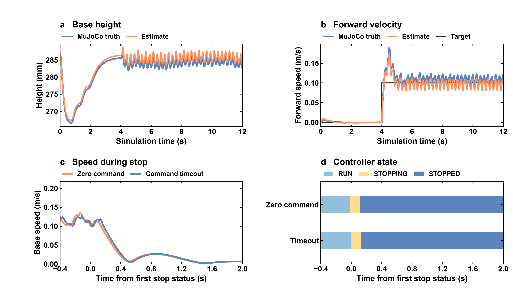
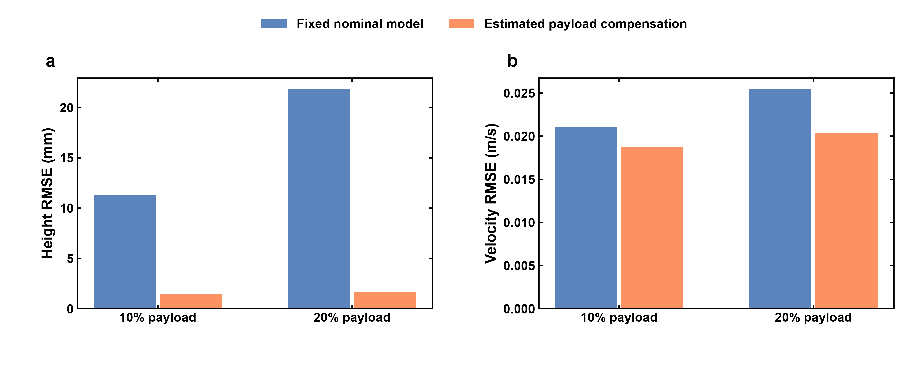
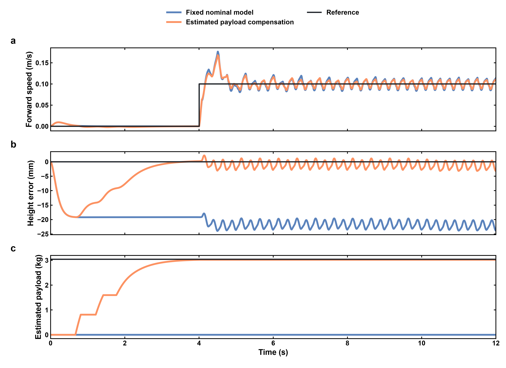
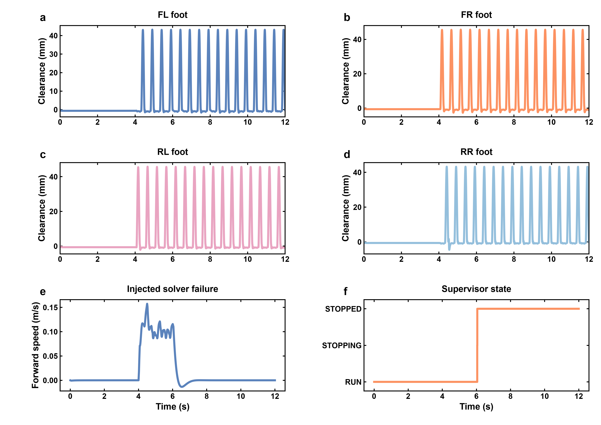

# Go2 Payload-Aware Motion Control

**四足机器人负载补偿、预测控制与约束力矩控制**

MuJoCo · Linear MPC · Inverse Dynamics QP · C++17 / Eigen · ROS 2 Humble

[结果与边界](PROJECT_STATUS.md) · [从零到一讲解](LESSON.md) · [传感器与 ROS 2](SENSOR_ROS.md) · [验收数据](reports/sensor_v2/ACCEPTANCE.json)

本项目在 Go2 上实现“站立估计等效载荷 → 冻结估计并启动行走 → MPC 预测接触力 → 全身动力学 QP 输出关节力矩”的仿真流程，
并加入独立 MPC 工作线程、过期解拒绝和连续求解失败后的停止状态机。
**v2 已完成平地传感器闭环和 ROS 2 联调。** v1 的力矩控制、负载对照与故障注入结果见下文。

## v2 传感器闭环与 ROS 2

IMU、关节编码器和足端接触位经 C++17/Eigen 估计机身状态，再进入 250 Hz 运动控制循环。ROS 2 收发速度指令、IMU、关节状态、里程计和运行状态。CMake/CTest 提供 C++ 构建和估计器检查。



| 仿真工况 | 高度估计 RMSE | 前进速度跟踪 RMSE | 验收 |
|---|---:|---:|---|
| 标称载荷，12 s | 0.89 mm | 0.0136 m/s | 通过 |
| +20% 载荷，12 s | 1.03 mm | 0.0152 m/s | 通过 |
| ROS 2 指令超时，+20% 载荷 | 1.11 mm | 0.0206 m/s | 受控停步 |
| ROS 2 零速度指令，+20% 载荷 | 1.09 mm | 0.0223 m/s | 受控停步 |

+20% 载荷回合估计 **3.020 kg**，实际 **3.041 kg**。在该回合的行走评分段，三维速度估计 RMSE 为 **0.0122 m/s**，三维位置估计 RMSE 为 **4.16 cm**。独立 DDS 节点在两次停步测试中分别收到每个话题 227 条消息。测量范围为 WSL 平地仿真，使用固定初始状态与载荷，详见 [复现与接口](SENSOR_ROS.md)。

## v1 负载补偿与优化控制



## 已完成能力

| 模块 | 实现 | 入口 |
|---|---|---|
| 动力学与力矩接口 | 官方 Go2 MJCF 只读加载，12 个直接力矩输入，18 维浮动基座速度；核对静态平衡与足端雅可比 | dynamics_audit.py |
| 等效载荷估计 | 从名义关节动力学与执行力矩重建支撑力，低速/低加速度门控、0.3秒静态窗口及低通滤波 | static_payload_observer.py |
| 预测控制 | 12维线性刚体近似、10步预测、20ms离散步长，摩擦/法向力/接触时序约束，OSQP工作区复用 | locomotion_control.py |
| 力矩控制 | 全名义动力学QP；支撑脚运动约束、摆腿加速度任务、摩擦与关节力矩约束 | locomotion_control.py |
| C++ 核心 | 质心预测输入矩阵、对角小跑时序、五次水平/四次抬脚轨迹；Python ctypes调用 | cpp/control_core.cpp |
| 调度与异常 | 50Hz MPC工作线程、250Hz配置的关节循环，异常/过期解拒绝、连续失败后完成摆腿并停止 | locomotion_control.py |
| 验证与可视化 | 固定工况、原始时序、故障注入、C++数值对照与图表脚本 | evaluate_walking.py |

动态惯量保持名义值；载荷估计在前4秒四足站立期间更新，行走时冻结。
本项目没有实现两足支撑运动中的在线质量辨识，也没有使用仿真真实载荷或接触力作为估计器输入。

## 最终行走结果

每工况12秒：前4秒站立，后8秒以0.1m/s前进；误差评分窗口为第5到12秒。
各工况只有一次初始状态轨迹，异步调度有运行差异，未构造置信区间或普遍性能结论。

| 工况 | 控制方式 | 高度RMSE mm | 平面速度RMSE m/s | 结果 |
|---|---|---:|---:|---|
| 标称 | 估计补偿 | 1.446 | 0.01696 | 通过 |
| +10%质量 | 固定名义参数 | 11.281 | 0.02102 | 通过 |
| +10%质量 | 估计补偿 | 1.484 | 0.01871 | 通过 |
| +20%质量 | 固定名义参数 | 21.827 | 0.02546 | 高度门槛未通过 |
| +20%质量 | 估计补偿 | 1.644 | 0.02037 | 通过 |
| +20%质量、力矩噪声及推力 | 估计补偿 | 1.712 | 0.03450 | 通过 |
| 连续求解失败注入 | 受控停止 | 0.658 | 不作跟踪验收 | 停止通过 |
| 摆腿阶段连续失败 | 完成落脚后停止 | 0.682 | 不作跟踪验收 | 停止通过 |

补偿使本次10%/20%负载行走的高度RMSE分别降低约 **86.8% / 92.5%**。
20%补偿工况实际抬脚约45.8mm，并记录到真实接触切换；不是仅输出一条预设机身位移轨迹。
力矩噪声标准差0.03Nm，种子2026；水平推力20N，持续0.15秒。
停止案例最终速度约1.85e-6m/s。它验证特定停止流程，不是完整的功能安全认证。



## 调度与实时性边界

同步版本暴露了MPC占用关节循环的问题。最终采用单独MPC线程与非阻塞结果读取，
并在20ms求解耗时预算、80ms解龄和连续失败条件下拒绝/降级。
最终关节控制计算P99约3.31–3.67ms；仍有超过4ms的计算以及16–52次/3000周期（最初七场景；完整记录见FINAL_RESULTS）的调度迟到。
因此250Hz是配置频率，当前WSL平台未达到严格的硬实时保证。
优化前、缓存同步版本和最终异步版本的数据均在本机保留；公开交付以 walking_async_final 为准。



## 环境与运行

实测：WSL2 / Ubuntu 22.04，Python3.11，NumPy2.4.6、SciPy1.17.1、
MuJoCo3.5.0、OSQP1.0.4、g++11.4.0。构建使用 make 4.3、CMake 3.22.1 和 Eigen 3.4.0。完整 Python 依赖见 requirements.txt。
控制计算使用CPU；未使用强化学习训练或云计算。

当前工作站：
```bash
cd /root/robotrl_go2/go2-payload-control
source .venv/bin/activate
bash build.sh
OPENBLAS_NUM_THREADS=1 OMP_NUM_THREADS=1 python check_cpp.py
OPENBLAS_NUM_THREADS=1 OMP_NUM_THREADS=1 python check_supervisor.py
# 匹配的已有评测结果会复用，不重复启动物理实验
OPENBLAS_NUM_THREADS=1 OMP_NUM_THREADS=1 python evaluate_walking.py
python plot_results.py
```

当前 .venv 只新增OSQP，使用 .pth 只读复用原go2rl已有数值库；原环境未升级。
在其他机器上，请新建独立Python3.11环境，安装 requirements.txt，并配置官方模型依赖。
该独立机器安装模板尚未在第二台机器验证：

```bash
# Ubuntu 22.04 的构建依赖
sudo apt install g++ make cmake libeigen3-dev
# 将官方 unitree_rl_mjlab 放在本仓库的同级目录，固定到下列提交
git clone https://github.com/unitreerobotics/unitree_rl_mjlab.git ../unitree_rl_mjlab
git -C ../unitree_rl_mjlab checkout 1425b15f73bd4095f0df53709d7c389c3eb9e790
python3.11 -m venv .venv
source .venv/bin/activate
python -m pip install -r requirements.txt
bash build.sh
```

单独运行一个新的本地实验（不会覆盖交付结果）：
```bash
OPENBLAS_NUM_THREADS=1 OMP_NUM_THREADS=1 python run_walking.py --name my_trial --report-root local_runs --load 0.2
```

图形演示入口：
```bash
OPENBLAS_NUM_THREADS=1 OMP_NUM_THREADS=1 python demo.py --load 0.2 --seconds 12
```
图形窗口本轮未单独打开验收；其控制与物理核心使用已验证模块，GUI入口仅检查了命令行参数。
已有源数据可直接看图，无需重新运行实验。

## 数据、方法与复现说明

- configs/walking_eval.json 在正式评测前固定门槛：速度RMSE<=0.05m/s、高度RMSE<=20mm、倾角<=5°等。
- reports/walking_async_final 包含8个工况的完整时序和汇总；每工况3000个控制时刻。
- reports/comparison.json 保存先前站立补偿的结果，不能与行走评分窗口混用。
- reports/cpp_checks.json、cache_checks.json、supervisor_checks.json 与 constraint_checks.json 记录针对性检查。
- figures/figure_contract.json 记录图表选材、变换、无误差带的原因和样式；PNG/SVG/PDF随源码交付，TIFF在本地保留。
- 测量时源文件与最终异常处理增补之间的关系见 reports/BENCHMARK_PROVENANCE.json。
- v1 行走对照直接使用仿真机身状态。v2 传感器闭环的独立记录见 reports/sensor_v2。
- 持续向下外力与附加载荷不可由当前静态观测唯一分辨；力矩限值来自上游配置，未经实机标定。

## 来源与许可

Go2模型来自 [Unitree RL Mjlab](https://github.com/unitreerobotics/unitree_rl_mjlab)，固定提交
1425b15f73bd4095f0df53709d7c389c3eb9e790；模型及网格保持外部依赖。
MPC的稀疏QP接口参考 [OSQP官方示例](https://osqp.org/docs/examples/mpc.html)。
本项目独立实现线性刚体MPC和控制集成，未安装或调用候选Quadruped-PyMPC框架。
代码许可及归属见 LICENSE 和 NOTICE。

Windows D盘目录为便于查看的交付副本，当前运行入口仍为 /root/robotrl_go2/go2-payload-control。学习时可用VS Code的WSL连接打开该Linux目录；修改D盘副本不会自动改变Linux源码。
